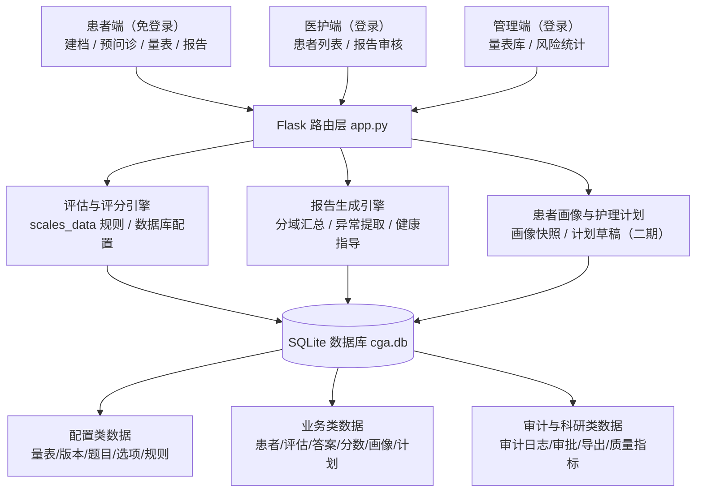
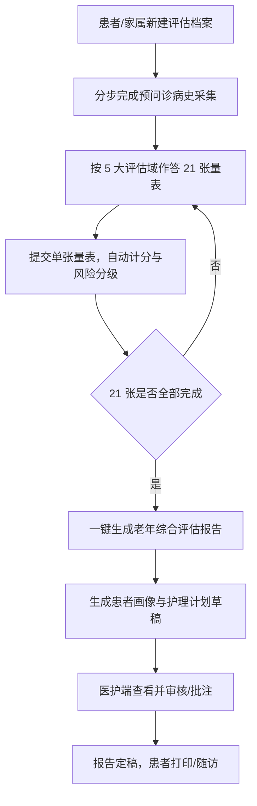
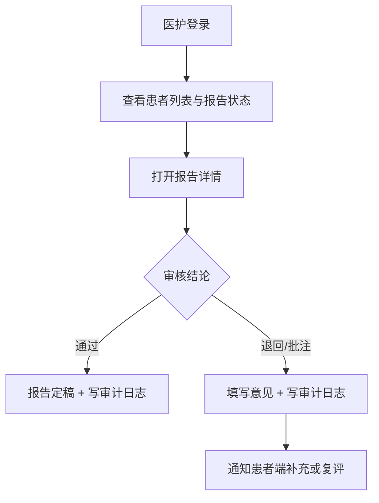

# 老年预问诊与老年综合评估系统 · 项目构想总需求（二期）

> 参考模板：`medical-evaluate-main/docs/项目构想总需求.md`
> 项目阶段：第二期（轻量化 demo）
> 技术栈原则：**保留原 demo 技术栈** —— Python + Flask + SQLite + 原生 HTML/CSS/JS，不引入 FastAPI / PostgreSQL / 前后端分离框架。

---

## 1. 项目定位

本项目面向社区与病区的老年人群，以**预问诊**为入口，完成**老年综合评估（CGA）**的数字化采集、自动评分、风险分级、综合报告生成、医护审核与健康指导，并向「评估—审核—干预—随访」闭环演进。

系统分为三端：

- **患者端**：免登录，患者本人或家属可新建评估档案、完成预问诊病史采集、作答 21 张量表、查看与打印综合报告。
- **医护端**：登录后查看患者列表、审核/批注/退回评估报告，确认风险结论。
- **管理端**：查看量表库使用情况、风险分布与业务统计，维护配置。

与参考项目 `medical-evaluate` 的关系：借鉴其业务思想（CICARE 沟通、分级宣教、Teach-back、知情同意、人机协同对比），但**按课程 demo 体量裁剪**，只实现可运行的最小闭环；暂不引入 AI 对话、语音网关、消息队列等重型能力，相关模块纳入二期/三期规划。

### 1.1 项目目标

| 目标 | 说明 |
|---|---|
| 评估数字化 | 21 张老年综合评估量表全部结构化、可作答、可自动计分 |
| 结果可解释 | 每张量表输出得分、风险等级与健康指导建议 |
| 流程可闭环 | 建档 → 预问诊 → 量表 → 报告 → 医护审核 → 打印/随访 |
| 配置可维护 | 量表结构、选项分值、评分规则从硬编码迁移为**数据库配置**，支持版本化 |
| 数据可追溯 | 评估答案逐题留痕、评分关联量表版本、关键操作写审计日志 |
| 适老化 | 大字号、高对比、浏览器语音朗读题目，降低老年人使用门槛 |

---

## 2. 文档资料范围

| 资料类别 | 当前来源 | 系统用途 |
|---|---|---|
| 老年综合评估量表 | 项目内 `scales_data.py`（21 张量表题库） | 问卷配置、评分规则、风险分级 |
| 健康指导知识库 | 项目内 `ADVICE_KB` | 异常指标匹配健康指导建议 |
| 量表评分规则 | `scales_data.py` 中每张量表的 `rule` 函数 | 自动计分、风险等级判定 |
| 宣教材料 | 二期规划（尚未建设） | 分级宣教、Teach-back |
| 知情同意书 | 二期规划（尚未建设） | 条款结构化、语音宣讲 |

> 当前 demo 以「量表 + 评分 + 报告」为主线，宣教与知情同意资料在二期仅做数据结构预留。

## 3. 用户角色

| 角色 | 主要能力 |
|---|---|
| 患者 / 家属 | 新建档案、填写预问诊病史、作答量表、查看/打印报告 |
| 护士（医护端） | 查看患者评估、审核/批注报告、确认风险结论 |
| 护理管理者 / 管理员 | 维护量表配置、查看量表库与风险分布统计、管理账号 |
| 科研人员（二期弱化） | 查看评估数据分布，后续支持脱敏导出 |

---

## 4. 总体系统架构

架构说明：

- **单进程 Flask 应用**，路由、评分、报告生成集中在 `app.py`，量表数据在 `scales_data.py`，二期起量表结构化配置落库。
- **SQLite 单文件数据库** `cga.db`，首次启动自动建库建表，无需额外中间件。
- **原生前端**：`templates/` 下 13 个 Jinja2 模板，无 npm 构建、无前端框架。

---

## 5. 核心模块设计

### 5.1 预问诊病史采集模块

分步引导采集老年人关键病史，降低漏问率。

| 能力 | 说明 |
|---|---|
| 分步采集 | 主诉 → 现病史 → 既往史 → 用药 → 过敏 → 家族史 → 生活习惯 |
| 结构化存储 | 病史字段落入 `patients` 表，可被报告与后续模块引用 |
| 完成状态 | `previsit_status` 标记未开始/进行中/已完成 |
| 过敏与用药提醒 | 过敏史、长期用药作为报告重点提示项 |

### 5.2 量表问卷与自动计分模块

| 能力 | 说明 |
|---|---|
| 量表列表 | 按 5 大评估域分组展示 21 张量表，显示完成进度 |
| 问卷作答 | 单选为主，支持浏览器语音朗读题目（Web Speech API） |
| 自动计分 | 提交即按评分规则计算总分 |
| 风险分级 | 按量表阈值输出正常/低/中/高风险等等级 |
| 历史记录 | 保存每次作答答案、得分、风险等级、量表版本 |

一期已实现 21 张量表，覆盖 5 大评估域：

| 评估域 | 量表 |
|---|---|
| 躯体功能 | Barthel、Lawton IADL、Tinetti 平衡步态、EAT-10 吞咽、ICIQ-SF 尿失禁 |
| 认知心理 | MMSE、DASC-21、CDR、GDS-15 抑郁、GAD-7 焦虑 |
| 营养代谢 | MNA-SF 营养、FRAIL 衰弱、SARC-F 肌少症、Beers 多重用药、Charlson 共病 |
| 安全风险 | Morse 跌倒、PSQI 睡眠、NRS 疼痛、Braden 压疮 |
| 社会功能 | LSNS-6 社会网络、EQ-5D 生活质量 |

### 5.3 综合报告与风险解释模块

| 能力 | 说明 |
|---|---|
| 分域汇总 | 按 5 大评估域汇总得分与异常项 |
| 异常指标提取 | 依据风险等级关键词识别异常量表 |
| 风险结论 | 按异常项数量输出轻度/中度/高度风险结论 |
| 健康指导 | 通过 `ADVICE_KB` 为异常量表匹配指导建议 |
| 报告生成 | 一键生成 HTML 报告，支持打印/导出 PDF |
| 待审核状态 | 报告生成后进入「待审核」，医护确认后定稿 |

### 5.4 患者画像与护理计划模块（二期落地草稿）

| 能力 | 说明 |
|---|---|
| 画像快照 | 按评估域聚合维度得分、风险标签，生成 `patient_profiles` 快照 |
| 护理计划草稿 | 根据异常项匹配护理重点与宣教重点，写入 `nursing_plans`（状态 `draft`） |
| 护士确认 | 计划需护士确认后才视为生效，明确责任边界 |
| 证据来源 | 记录画像来源（系统/护士），为后续人机对比预留 |

### 5.5 医护审核与质控模块

| 能力 | 说明 |
|---|---|
| 患者列表 | 展示患者、量表完成数、报告状态 |
| 报告审核 | 通过 / 退回 / 批注，写入 `reports` 与审计日志 |
| 风险确认 | 护士确认后的结果作为临床最终记录 |
| 审计留痕 | 建档案、提交量表、审核报告写入 `clinical_audit_logs` |

### 5.6 管理端统计模块

| 能力 | 说明 |
|---|---|
| 量表库使用统计 | 各量表被使用次数 |
| 风险分布 | 各风险等级人数分布 |
| 业务概览 | 患者总数、预问诊完成数、报告总数、已审核数 |

### 5.7 二期规划模块（本期只设计、不落地）

以下模块参考 `medical-evaluate`，纳入后续期次：

| 模块 | 规划要点 |
|---|---|
| CICARE 对话问询 | 六阶段话术模板、问题口语化、中断恢复、安全边界 |
| 追问与实时宣教 | 基于答案触发追问与宣教，规则来自配置表 |
| 知情同意语音宣讲 | 条款结构化、重点强调、理解确认、留痕 |
| 分级宣教与 Teach-back | 常规宣教/医学常识宣教区分，理解确认与人工兜底 |
| 人机协同与科研对比 | AI 结果与护士结果差异记录、脱敏导出、质量指标 |

---

## 6. 核心业务流程

### 6.1 评估主流程

### 6.2 医护审核流程

---

## 7. 技术栈选择

本项目为课程第二期 demo，**延续一期技术栈**，以「零外部中间件、可一键运行」为首要约束。

| 层次 | 选型 | 版本/说明 | 选择理由 |
|---|---|---|---|
| 后端框架 | Python + Flask | Flask ≥ 2.3 | 轻量、单文件路由、学习成本低，匹配课程规模 |
| 数据库 | SQLite（标准库 `sqlite3`） | 免安装，运行生成 `cga.db` | 无需部署数据库服务，便于演示与提交 |
| 前端 | 原生 HTML + CSS + JavaScript | Jinja2 模板 | 无 npm 构建、无框架依赖，适老化样式易控 |
| 语音朗读 | 浏览器 Web Speech API | 前端内置 | 无外部服务依赖 |
| 图表 | matplotlib | 仅开发期出图，非运行依赖 | 需要时生成统计图 |

### 7.1 与参考项目技术栈的差异（有意保留）

| 维度 | 参考项目 medical-evaluate | 本项目（二期 demo） |
|---|---|---|
| 后端 | FastAPI + asyncio + Celery | Flask 同步单进程 |
| 数据库 | PostgreSQL + SQLAlchemy + Alembic | SQLite + 原生 SQL |
| 缓存/队列 | Redis Stream + Celery | 无 |
| 前端 | Next.js + React + Tailwind | 原生 HTML/CSS/JS + Jinja2 |
| AI 能力 | LangChain/LangGraph + 语音网关 | 规则评分，AI 能力列入后续期次 |

> 结论：**数据库设计思想对齐参考项目第 8 步的三类划分，具体实现按 SQLite 语法落地**，既满足需求，又不破坏原技术栈。

---

## 8. 数据模型设计（重点）

### 8.1 数据库选型与 SQLite 适配

需求模板以 PostgreSQL 描述，本项目保持 SQLite，做如下类型映射：

| PostgreSQL 概念 | SQLite 实现 | 说明 |
|---|---|---|
| `SERIAL` / `BIGSERIAL` | `INTEGER PRIMARY KEY AUTOINCREMENT` | 自增主键 |
| `TIMESTAMP` | `TEXT`（ISO8601，如 `2026-10-21 14:30`） | 沿用现有时间格式 |
| `JSONB` | `TEXT` | 存 JSON 字符串 |
| `BOOLEAN` | `INTEGER`（0/1） | SQLite 无原生布尔 |
| `DECIMAL` | `INTEGER` / `REAL` | 分数用 INTEGER，比例用 REAL |
| 外键约束 | `REFERENCES ... ON DELETE CASCADE` + `PRAGMA foreign_keys=ON` | `get_db()` 已开启 |

### 8.2 数据表分类总览

数据表按**变更频次与生命周期**分为三类，共 28 张（含一期已有 4 张的归位）：

| 类别 | 数量 | 数据性质 | 谁维护 | 是否进入临床最终记录 |
|---|---|---|---|---|
| 配置类 | 10 | 量表结构、选项分值、评分规则、话术、宣教模板 | 护理管理者/管理员 | 否（仅被引用） |
| 业务类 | 13 | 患者、评估任务、答案、分数、画像、计划、复核 | 患者/护士/系统 | 是 |
| 审计与科研类 | 5 | 审批、审计、导出、脱敏、质量指标 | 系统自动 | 是（脱敏/派生） |

**分类设计思路**：

1. **配置与业务解耦**：量表改题不改历史答案；每次评估记录所用表单版本，满足版本追溯。
2. **可追溯**：答案逐题落表，评分关联表单版本，关键操作写审计。
3. **安全边界清晰**：审计与科研类单独成表，便于权限控制与脱敏导出。

### 8.3 配置类数据（10 张）

> 职责：描述「评估工具长什么样」，由管理员维护，审批后发布供业务引用。

| 表名 | 作用 | 关键字段（字段归类） |
|---|---|---|
| `form_templates` | 量表模板主档，如 Barthel、MMSE | `id`(标识)、`code`(标识/唯一)、`name`(内容)、`domain`(内容)、`mode`(内容)、`current_version`(状态)、`created_at`(审计) |
| `form_versions` | 量表版本，支持审批发布与历史追溯 | `id`(标识)、`template_id`(关联)、`version`(状态)、`published_status`(状态)、`effective_from`(状态)、`approved_by`(审计) |
| `form_sections` | 表单分组 | `id`(标识)、`template_id`/`version_id`(关联)、`title`(内容)、`sort_order`(内容) |
| `form_questions` | 题目定义 | `id`(标识)、`template_id`/`version_id`/`section_id`(关联)、`seq`(内容)、`stem`(内容)、`q_type`(内容)、`max_score`(内容) |
| `form_options` | 选项与分值 | `id`(标识)、`question_id`(关联)、`label`(内容)、`value`(内容)、`sort_order`(内容) |
| `scoring_rules` | 总分公式、分项规则、等级解释 | `id`(标识)、`template_id`/`version_id`(关联)、`rule_key`(内容)、`total_formula`(内容)、`grade_bands`(内容/JSON) |
| `education_materials` | 宣教材料（原文/通俗/播报） | `id`(标识)、`title`/`category`/`content_raw`/`content_simple`/`content_audio`(内容)、`risk_tags`(内容)、`created_at`(审计) |
| `consent_templates` | 知情同意书结构化模板 | `id`(标识)、`title`/`type`/`clauses`/`key_points`(内容)、`created_at`(审计) |
| `dialogue_scripts` | CICARE 话术、宣讲话术、追问话术 | `id`(标识)、`stage`/`scene`/`script_text`(内容)、`is_ai_generated`(状态) |
| `trigger_rules` | 追问、宣教、转人工、计划触发规则 | `id`(标识)、`condition_expr`/`action_type`(内容)、`target_material_id`(关联)、`risk_level`(内容) |

**关键设计思路**：

- 量表拆成「模板 → 版本 → 分组 → 题目 → 选项 → 评分规则」六层，满足需求 6.1 的表单/分组/题目/选项/分值拆分。
- 业务表只存 `form_version_id`，量表改版不影响历史数据。
- 评分规则的「规则函数」仍用 Python 实现（`scales_data.RULES` 注册表），`rule_key` 负责映射，`grade_bands` 存阈值，实现「规则可配置、可追溯」。

### 8.4 业务类数据（13 张）

> 职责：记录一次真实评估过程产生的数据，是临床最终记录来源。

| 表名 | 作用 | 关键字段（字段归类） |
|---|---|---|
| `patients` | 患者基础信息 + 预问诊病史 | `id`(标识)、`name`/`gender`/`age`/`phone`(内容)、`id_card`(内容/敏感)、`previsit_status`(状态)、`created_at`(审计) |
| `encounters` | 一次就诊/住院上下文 | `id`(标识)、`patient_id`(关联)、`encounter_no`(标识/唯一)、`admission_date`/`department`/`diagnosis_snapshot`(内容)、`status`(状态) |
| `assessment_sessions` | 一次评估任务 | `id`(标识)、`session_no`(标识/唯一)、`patient_id`/`encounter_id`(关联)、`collection_mode`(内容)、`template_ids`/`form_version_ids`(内容/审计)、`status`(状态) |
| `assessment_answers` | 患者每题回答 | `id`(标识)、`session_id`/`patient_id`(关联)、`scale_code`(关联)、`question_id`/`option_id`(关联)、`question_seq`/`option_value`/`answer_text`(内容)、`answered_at`(审计) |
| `assessment_scores` | 分项分、总分、等级 | `id`(标识)、`session_id`/`patient_id`(关联)、`scale_code`(关联)、`form_version_id`(审计)、`section_scores`/`total_score`/`risk_level`(内容)、`mode`(内容) |
| `dialogue_turns` | AI 与患者每轮对话 | `id`(标识)、`session_id`(关联)、`role`/`content`/`transcript`(内容)、`created_at`(审计) |
| `education_sessions` | 宣教记录 | `id`(标识)、`patient_id`/`material_id`(关联)、`status`(状态)、`confirmed_at`(状态)、`created_at`(审计) |
| `teachback_results` | Teach-back 问题、回答、结果 | `id`(标识)、`patient_id`(关联)、`question`/`answer`(内容)、`understood`(状态)、`created_at`(审计) |
| `consent_sessions` | 知情同意宣讲记录 | `id`(标识)、`patient_id`/`template_id`(关联)、`status`(状态)、`signature_path`(内容)、`created_at`(审计) |
| `patient_profiles` | 患者画像 | `id`(标识)、`patient_id`/`encounter_id`(关联)、`snapshot_at`(状态)、`dimension_scores`/`risk_tags`(内容)、`evidence_source`/`generated_by`(审计) |
| `nursing_plans` | 护理计划建议与护士确认 | `id`(标识)、`patient_id`/`encounter_id`/`profile_id`(关联)、`risk_summary`/`plan_items`/`education_focus`(内容)、`status`(状态)、`confirmed_by`(审计) |
| `nurse_reviews` | 护士复核、补充问诊、修正 | `id`(标识)、`patient_id`/`session_id`(关联)、`review_type`/`content`(内容)、`created_at`(审计) |
| `ai_nurse_comparisons` | AI 结果与护士结果对比 | `id`(标识)、`patient_id`(关联)、`scale_code`(关联)、`ai_result`/`nurse_result`/`diff_fields`/`diff_reason`(内容)、`created_at`(审计) |

**关键设计思路**：

- 一期 `scale_results` 的 `answers` 为 JSON 字符串；二期拆出 `assessment_answers` 逐题落表，支持审计与「AI 答案 vs 护士修正」对比。
- 引入 `encounters` 后，同一患者多次就诊可独立评估，对齐参考项目 `patient → encounter → session` 主链路。
- 画像与护理计划由报告生成逻辑产出「草稿」，护士确认前不生效，明确责任边界。

### 8.5 审计与科研类数据（5 张）

| 表名 | 作用 | 关键字段（字段归类） |
|---|---|---|
| `template_approvals` | 模板审批记录 | `id`(标识)、`template_type`/`template_id`(关联)、`status`(状态)、`approved_by`(审计)、`created_at`(审计) |
| `clinical_audit_logs` | 临床操作审计 | `id`(标识)、`actor`/`actor_role`(审计)、`action`/`target_type`/`detail`(内容)、`target_id`(关联)、`created_at`(审计) |
| `data_exports` | 科研数据导出记录 | `id`(标识)、`export_name`/`scope`/`deidentify_params`(内容)、`created_by`(审计)、`created_at`(审计) |
| `deidentified_records` | 脱敏科研数据快照 | `id`(标识)、`export_id`(关联)、`payload`(内容)、`created_at`(审计) |
| `model_quality_metrics` | AI 问询质量、修正率、一致率 | `id`(标识)、`metric_name`/`metric_value`/`sample_n`(内容)、`created_at`(审计) |

**关键设计思路**：呼应需求 10「审计日志：记录谁创建、修改、确认、导出数据」。二期在建档、提交量表、审核报告处写入 `clinical_audit_logs`，打通基础质控；其余表为后续科研与 AI 质量评估预留。

### 8.6 字段归类方法论（作业重点）

每张表的字段按职责归为 5 类，贯穿全部 28 张表：

| 字段类别 | 判据 | 典型例子 |
|---|---|---|
| 标识字段（Identity） | 用于唯一定位对象，不参与业务计算 | `id`、`session_no`、`encounter_no`、`code` |
| 归属/关联字段（Reference） | 表达实体间「谁属于谁」，外键 | `patient_id`、`template_id`、`version_id`、`question_id` |
| 内容/业务字段（Payload） | 直接承载业务结果 | `score`、`answers`、`risk_level`、`content`、`plan_items` |
| 状态/生命周期字段（State） | 描述对象所处阶段或版本 | `status`、`published_status`、`previsit_status`、`created_at` |
| 审计/溯源字段（Audit） | 用于追责、版本回放、责任边界 | `created_by`、`source`、`form_version_id`、`generated_by` |

**归类判据（一句话）**：问「这个字段变了，要不要影响历史记录？」
- 要 → 归入**配置类**并加版本；
- 不要但属于过程 → 归入**业务类**；
- 用于追责/统计 → 归入**审计与科研类**。

### 8.7 落地状态与迁移关系

| 状态 | 表 |
|---|---|
| 一期已存在 | `users`、`patients`、`scale_results`、`reports` |
| 二期已落库（本次） | 配置类 6 张核心表（`form_templates`/`form_versions`/`form_sections`/`form_questions`/`form_options`/`scoring_rules`）、业务类 6 张（`encounters`/`assessment_sessions`/`assessment_answers`/`assessment_scores`/`patient_profiles`/`nursing_plans`）、审计 1 张（`clinical_audit_logs`） |
| 二期建表预留 | 配置类 4 张、业务类 6 张、审计科研类 4 张 |

原 4 张表的二期处理：

| 原表 | 处理方式 |
|---|---|
| `users` | 不变 |
| `patients` | 不变，`encounters` 挂靠其上 |
| `scale_results` | 保留为报告聚合视图；新增 `assessment_answers` + `assessment_scores` 作为标准化替代 |
| `reports` | 不变；新增 `patient_profiles` + `nursing_plans` 作为结构化伴随产物 |

---

## 9. AI 能力设计（二期规划）

当前 demo 为**规则驱动的确定性评分**，不依赖大模型，保证结果可复现、可解释。AI 能力按「受控助手」定位纳入后续期次：

| AI 能力 | 设计边界 |
|---|---|
| 问题口语化 | 可将量表题目改写得更易懂，但必须绑定原始题目 ID |
| 智能追问 | 基于规则触发，追问内容来自审核模板 |
| 实时宣教 | 基于患者回答触发，内容来自知识库 |
| Teach-back 判断 | 可辅助判断理解与否，但保留原始回答与判断依据 |
| 护理计划草案 | 根据评分与规则生成建议，由护士最终确认 |
| 异常识别 | 识别高风险、不理解、拒绝回答并转人工 |

**不建议 AI 直接做**：独立诊断、修改医嘱、自行发明宣教内容、隐式改变评分规则。

---

## 10. 安全、合规与质控设计

| 方向 | 设计要求 | 本项目实现 |
|---|---|---|
| 身份与权限 | 医护/管理员分级访问 | Flask `session` + `login_required(role)` 装饰器 |
| 模板审批 | 表单、宣教、规则上线前审批 | `template_approvals` 预留 |
| 版本追溯 | 每次评估记录模板版本 | `assessment_scores.form_version_id` |
| 最终责任 | 护士确认后为临床最终记录 | `reports.status`、`nursing_plans.confirmed_by` |
| 隐私保护 | 身份信息、科研导出需权限与脱敏 | `patients.id_card` 敏感字段，导出预留脱敏 |
| 审计日志 | 记录谁创建、修改、确认、导出 | `clinical_audit_logs` |
| 转人工机制 | 高风险/不理解/拒绝转护士 | 后续对话模块实现 |
| 内容边界 | 不承诺疗效、不替代医生诊疗 | 规则化健康指导，标注「建议就医」 |

---

## 11. 一期（当前 demo）范围

一期目标是验证「预问诊 + 量表问卷 + 自动计分 + 报告 + 医护审核 + 数据留痕」可用。

| 模块 | 已完成范围 |
|---|---|
| 预问诊 | 主诉、现病史、既往史、用药、过敏、家族史、生活习惯 |
| 量表问卷 | 21 张量表、5 大评估域、分组作答、语音朗读 |
| 自动计分 | 每张量表规则化计分与风险分级 |
| 综合报告 | 分域汇总、异常提取、风险结论、健康指导、打印 |
| 医护工作台 | 患者列表、报告审核/批注/退回 |
| 管理端 | 量表库使用统计、风险分布、业务概览 |
| 数据库 | SQLite 4 张表，session 登录与角色控制 |

---

## 12. 二期范围与后续扩展

| 阶段 | 目标 |
|---|---|
| 二期（本期） | 量表配置落库与版本化；补 `encounters`/`assessment_sessions`/`assessment_answers`/`assessment_scores`；生成患者画像与护理计划草稿；写入审计日志；完善数据库设计文档 |
| 三期 | 引入 CICARE 对话问询、追问与实时宣教、知情同意语音宣讲 |
| 四期 | 分级宣教与 Teach-back、人机协同对比、科研脱敏导出 |
| 五期 | 与院内 HIS/EMR 对接，回写护理记录；多科室模板库 |

---

## 13. 当前关键待确认问题

| 问题 | 影响 |
|---|---|
| Braden 风险等级阈值 | 影响风险分级与护理计划触发 |
| 跌倒/压疮量表多选计分策略 | 影响总分准确性 |
| 量表核心/筛查条目的临床完整性 | 作业版为精简条目，正式版需补全 |
| 患者画像维度权重 | 影响画像与护理重点排序 |
| 护理计划措施库来源与审核 | 影响计划草稿可用性 |
| 敏感字段（身份证）加密与访问控制 | 影响隐私合规 |
| AI 结果能否直接进入护理记录 | 影响责任边界与审批流程 |

---

## 14. 建议下一步

1. 审批并确认二期三类数据表结构（本文档第 8 步），作为建表与迁移依据。
2. 完善量表配置落库后的管理界面（管理员维护模板/版本/规则）。
3. 补全患者画像维度权重与护理措施库，提升护理计划草稿质量。
4. 在关键操作处补齐审计日志，形成质控基线。
5. 选择 1-2 张量表试点「AI 口语化问询 + 护士复核」对比，为三期人机协同做准备。
6. 完成学生 Git 实践：按 `AGENTS.md` 的 Git 规范建分支、提交、合并。
